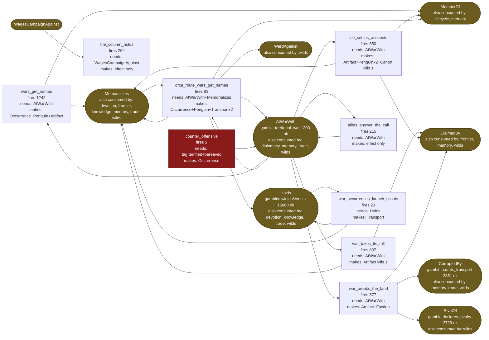
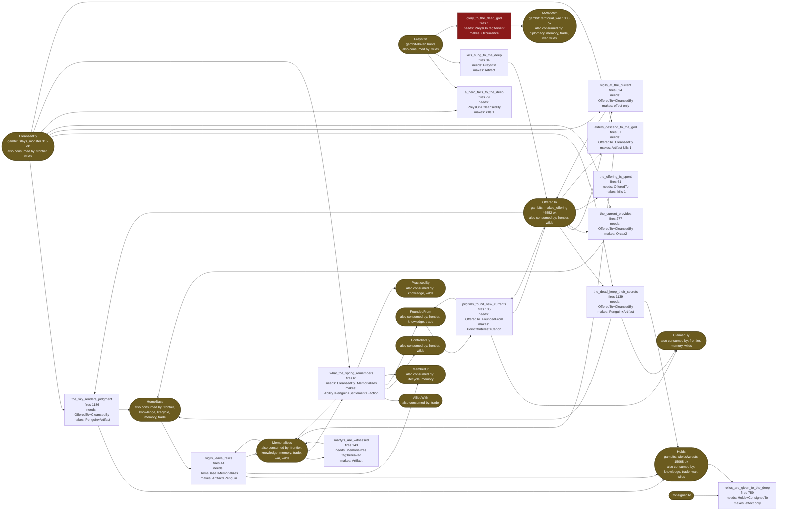
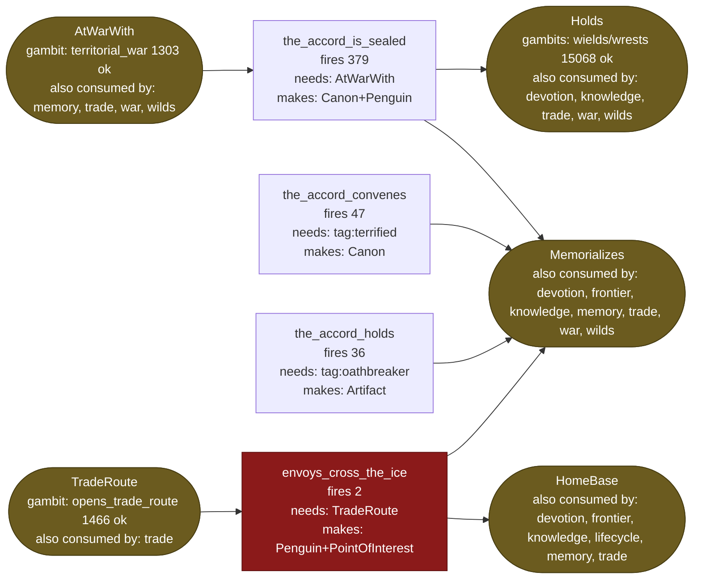
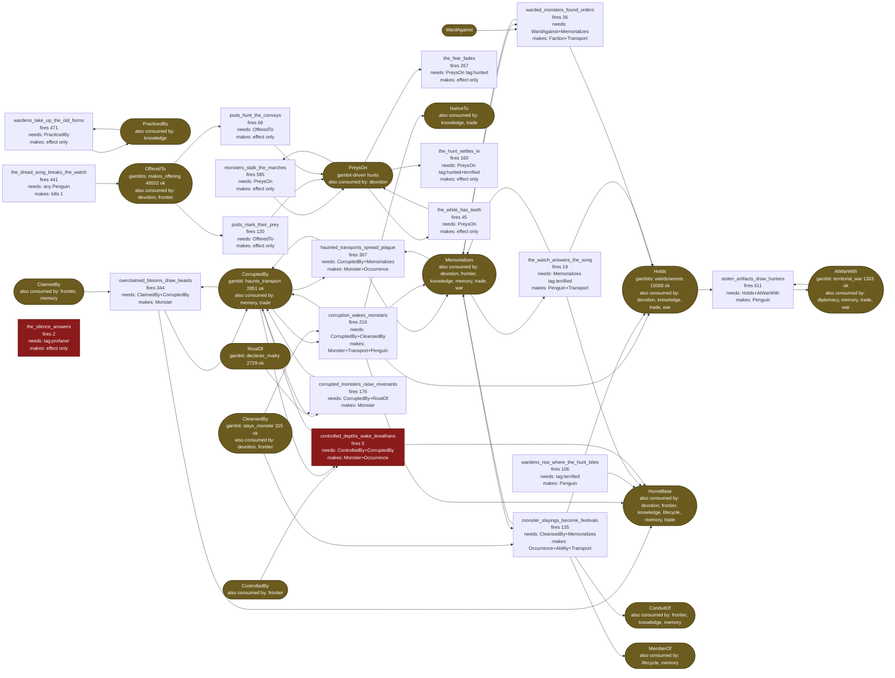
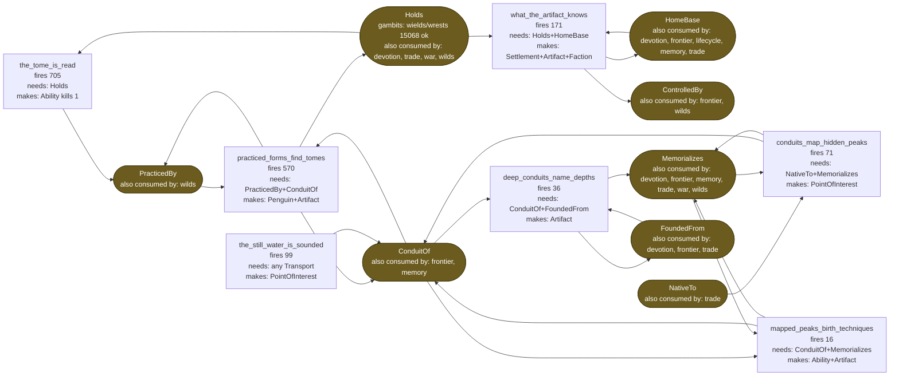
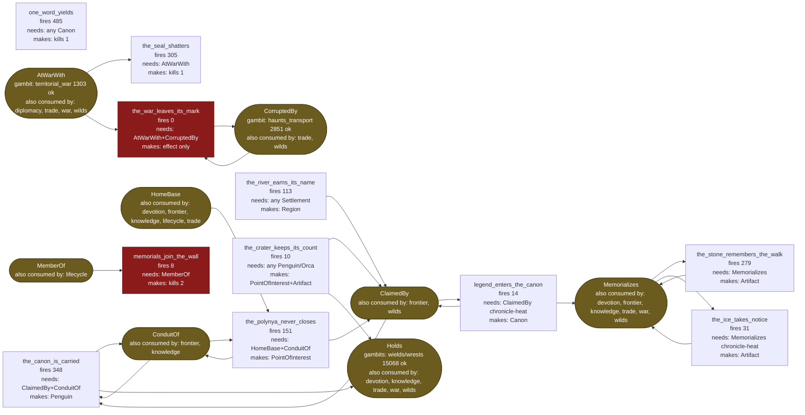
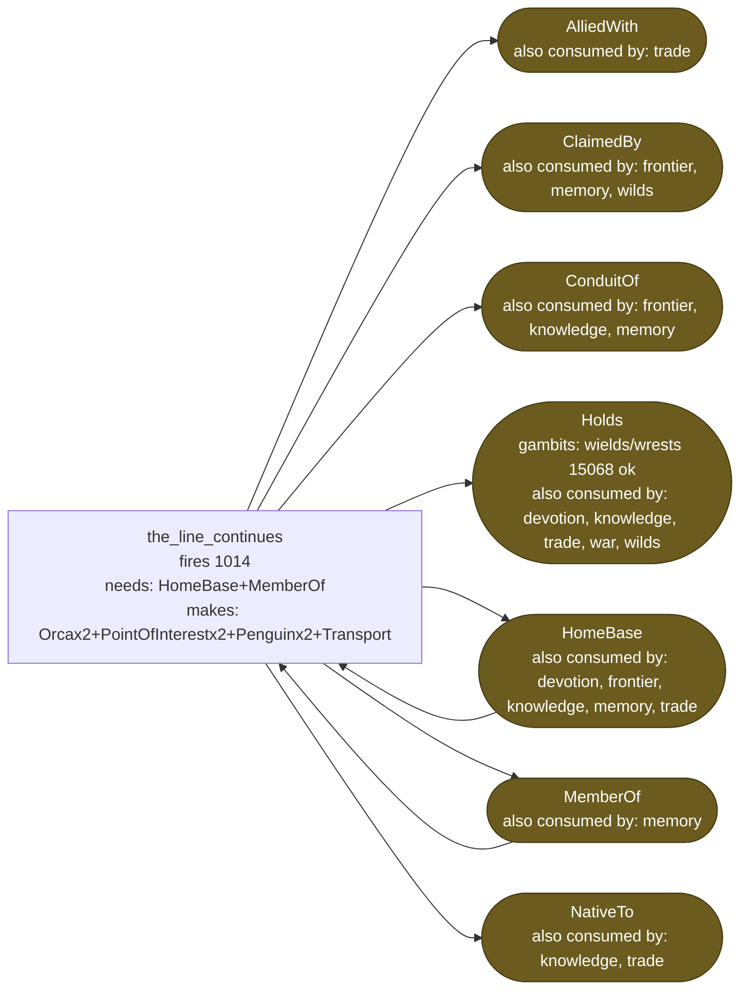
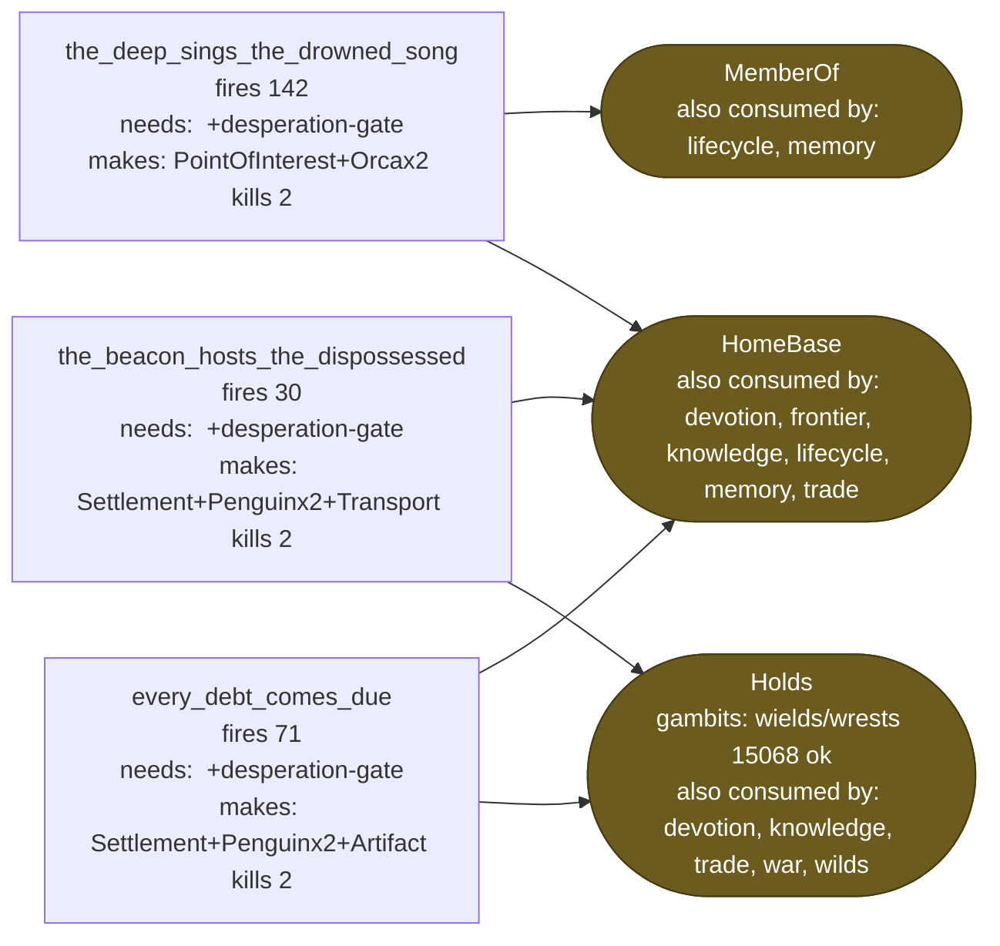

# Content causality web (2026-08-03)

Generated from the generator configs plus pooled fires across the nine
30k worlds. One diagram per track. Node lines: name / 9-world fires /
what world-state it needs / what it makes. Gold ovals are relationship
currencies: their labels say who mints them and which other tracks
also consume them. Red = deletion-survey candidate. Green = the gambit
engines that mint a currency (successes).

## war

## devotion

## trade

```mermaid
flowchart LR
  classDef cand fill:#8b1a1a,stroke:#5c0f0f,color:#fff
  classDef cur fill:#6b5b1f,stroke:#463c12,color:#fff
  classDef gam fill:#2d5b2d,stroke:#1d3d1d,color:#fff
  n_the_deep_conclave["the_deep_conclave<br/>fires 713<br/>needs: Holds<br/>makes: Penguin+Artifact+Canon"]
  cur_Holds --> n_the_deep_conclave
  n_the_deep_conclave --> cur_ClaimedBy
  n_the_deep_conclave --> cur_Holds
  n_records_cast_shadows["records_cast_shadows<br/>fires 674<br/>needs: Holds+Memorializes<br/>makes: Artifact+Penguin"]
  cur_Holds --> n_records_cast_shadows
  cur_Memorializes --> n_records_cast_shadows
  n_records_cast_shadows --> cur_Holds
  n_records_cast_shadows --> cur_Memorializes
  n_debtors_flee_to_the_open_court["debtors_flee_to_the_open_court<br/>fires 478<br/>needs: CorruptedBy+Memorializes<br/>makes: Penguin+Artifact+Settlement"]
  cur_CorruptedBy --> n_debtors_flee_to_the_open_court
  cur_Memorializes --> n_debtors_flee_to_the_open_court
  n_debtors_flee_to_the_open_court --> cur_Holds
  n_debtors_flee_to_the_open_court --> cur_HomeBase
  n_debtors_flee_to_the_open_court --> cur_Memorializes
  n_debtors_flee_to_the_open_court --> cur_TradeRoute
  n_wars_feed_shadow_brokers["wars_feed_shadow_brokers<br/>fires 332<br/>needs: AtWarWith<br/>makes: Penguin+Artifact"]
  cur_AtWarWith --> n_wars_feed_shadow_brokers
  n_wars_feed_shadow_brokers --> cur_Holds
  n_wars_feed_shadow_brokers --> cur_Memorializes
  n_rich_hubs_grow_undermarkets["rich_hubs_grow_undermarkets<br/>fires 284<br/>needs: TradeRoute+FoundedFrom<br/>makes: Settlement+Penguin+Artifact"]
  cur_TradeRoute --> n_rich_hubs_grow_undermarkets
  cur_FoundedFrom --> n_rich_hubs_grow_undermarkets
  n_rich_hubs_grow_undermarkets --> cur_FoundedFrom
  n_rich_hubs_grow_undermarkets --> cur_Holds
  n_rich_hubs_grow_undermarkets --> cur_HomeBase
  n_rich_hubs_grow_undermarkets --> cur_TradeRoute
  n_routes_draw_readers["routes_draw_readers<br/>fires 164<br/>needs: TradeRoute<br/>makes: Penguin+Faction+Artifact"]
  cur_TradeRoute --> n_routes_draw_readers
  n_routes_draw_readers --> cur_ControlledBy
  n_routes_draw_readers --> cur_FoundedFrom
  n_routes_draw_readers --> cur_HomeBase
  n_routes_draw_readers --> cur_MemberOf
  n_routes_draw_readers --> cur_NativeTo
  n_routes_draw_readers --> cur_TradeRoute
  n_charters_find_harbors["charters_find_harbors<br/>fires 124<br/>needs: Holds+NativeTo<br/>makes: Settlement+Penguin+Artifact"]
  cur_Holds --> n_charters_find_harbors
  cur_NativeTo --> n_charters_find_harbors
  n_charters_find_harbors --> cur_ControlledBy
  n_charters_find_harbors --> cur_HomeBase
  n_charters_find_harbors --> cur_NativeTo
  n_trade_routes_convene_negotiation["trade_routes_convene_negotiation<br/>fires 114<br/>needs: TradeRoute+Memorializes<br/>makes: Occurrence+Penguin+Artifact+Transport"]
  cur_TradeRoute --> n_trade_routes_convene_negotiation
  cur_Memorializes --> n_trade_routes_convene_negotiation
  n_trade_routes_convene_negotiation --> cur_Holds
  n_trade_routes_convene_negotiation --> cur_HomeBase
  n_trade_routes_convene_negotiation --> cur_MemberOf
  n_trade_routes_convene_negotiation --> cur_Memorializes
  n_trade_routes_convene_negotiation --> cur_NativeTo
  n_conferences_become_festivals["conferences_become_festivals<br/>fires 25<br/>needs: Memorializes+AlliedWith<br/>makes: Occurrence"]
  cur_Memorializes --> n_conferences_become_festivals
  cur_AlliedWith --> n_conferences_become_festivals
  n_conferences_become_festivals --> cur_HomeBase
  n_trade_conferences_raise_citadels["trade_conferences_raise_citadels<br/>fires 23<br/>needs: HomeBase+Holds<br/>makes: Transport"]
  cur_HomeBase --> n_trade_conferences_raise_citadels
  cur_Holds --> n_trade_conferences_raise_citadels
  n_trade_conferences_raise_citadels --> cur_Holds
  n_trade_conferences_raise_citadels --> cur_Memorializes
  cur_AlliedWith(["AlliedWith"]):::cur
  cur_AtWarWith(["AtWarWith<br/>gambit: territorial_war 1303 ok<br/>also consumed by: diplomacy, memory, war, wilds"]):::cur
  cur_ClaimedBy(["ClaimedBy<br/>also consumed by: frontier, memory, wilds"]):::cur
  cur_ControlledBy(["ControlledBy<br/>also consumed by: frontier, wilds"]):::cur
  cur_CorruptedBy(["CorruptedBy<br/>gambit: haunts_transport 2851 ok<br/>also consumed by: memory, wilds"]):::cur
  cur_FoundedFrom(["FoundedFrom<br/>also consumed by: devotion, frontier, knowledge"]):::cur
  cur_Holds(["Holds<br/>gambits: wields/wrests 15068 ok<br/>also consumed by: devotion, knowledge, war, wilds"]):::cur
  cur_HomeBase(["HomeBase<br/>also consumed by: devotion, frontier, knowledge, lifecycle, memory"]):::cur
  cur_MemberOf(["MemberOf<br/>also consumed by: lifecycle, memory"]):::cur
  cur_Memorializes(["Memorializes<br/>also consumed by: devotion, frontier, knowledge, memory, war, wilds"]):::cur
  cur_NativeTo(["NativeTo<br/>also consumed by: knowledge"]):::cur
  cur_TradeRoute(["TradeRoute<br/>gambit: opens_trade_route 1466 ok<br/>also consumed by: diplomacy"]):::cur
```

## diplomacy

## wilds

## frontier

```mermaid
flowchart LR
  classDef cand fill:#8b1a1a,stroke:#5c0f0f,color:#fff
  classDef cur fill:#6b5b1f,stroke:#463c12,color:#fff
  classDef gam fill:#2d5b2d,stroke:#1d3d1d,color:#fff
  n_cleansed_springs_found_sanctuaries["cleansed_springs_found_sanctuaries<br/>fires 251<br/>needs: CleansedBy+FoundedFrom<br/>makes: Settlement+Faction+Ability"]
  cur_CleansedBy --> n_cleansed_springs_found_sanctuaries
  cur_FoundedFrom --> n_cleansed_springs_found_sanctuaries
  n_cleansed_springs_found_sanctuaries --> cur_AlliedWith
  n_cleansed_springs_found_sanctuaries --> cur_ControlledBy
  n_cleansed_springs_found_sanctuaries --> cur_FoundedFrom
  n_cleansed_springs_found_sanctuaries --> cur_HomeBase
  n_cleansed_springs_found_sanctuaries --> cur_Memorializes
  n_cleansed_springs_found_sanctuaries --> cur_PracticedBy
  n_unclaimed_places_draw_wardens["unclaimed_places_draw_wardens<br/>fires 181<br/>needs: ClaimedBy<br/>makes: Penguin+Transport"]
  cur_ClaimedBy --> n_unclaimed_places_draw_wardens
  n_unclaimed_places_draw_wardens --> cur_ClaimedBy
  n_unclaimed_places_draw_wardens --> cur_ConduitOf
  n_unclaimed_places_draw_wardens --> cur_Holds
  n_unclaimed_places_draw_wardens --> cur_HomeBase
  n_unclaimed_places_draw_wardens --> cur_MemberOf
  n_unclaimed_places_draw_wardens --> cur_NativeTo
  n_conduit_points_found_reefholds["conduit_points_found_reefholds<br/>fires 124<br/>needs: ConduitOf+FoundedFrom<br/>makes: Settlement+Artifact+Penguin"]
  cur_ConduitOf --> n_conduit_points_found_reefholds
  cur_FoundedFrom --> n_conduit_points_found_reefholds
  n_conduit_points_found_reefholds --> cur_ConduitOf
  n_conduit_points_found_reefholds --> cur_FoundedFrom
  n_conduit_points_found_reefholds --> cur_Holds
  n_conduit_points_found_reefholds --> cur_HomeBase
  n_conduit_points_found_reefholds --> cur_TradeRoute
  n_bulls_range_the_far_currents["bulls_range_the_far_currents<br/>fires 47<br/>needs: OfferedTo<br/>makes: effect only"]
  cur_OfferedTo --> n_bulls_range_the_far_currents
  n_bulls_range_the_far_currents --> cur_HomeBase
  n_bulls_range_the_far_currents --> cur_MemberOf
  n_sanctuaries_anchor_colonies["sanctuaries_anchor_colonies<br/>fires 40<br/>needs: ControlledBy+FoundedFrom<br/>makes: Settlement+Faction+Transport"]
  cur_ControlledBy --> n_sanctuaries_anchor_colonies
  cur_FoundedFrom --> n_sanctuaries_anchor_colonies
  n_sanctuaries_anchor_colonies --> cur_AlliedWith
  n_sanctuaries_anchor_colonies --> cur_ConduitOf
  n_sanctuaries_anchor_colonies --> cur_ControlledBy
  n_sanctuaries_anchor_colonies --> cur_FoundedFrom
  n_sanctuaries_anchor_colonies --> cur_Holds
  n_sanctuaries_anchor_colonies --> cur_HomeBase
  n_sanctuaries_anchor_colonies --> cur_NativeTo
  n_sanctuaries_anchor_colonies --> cur_TradeRoute
  n_the_thaw_calls_the_bold["the_thaw_calls_the_bold<br/>fires 33<br/>needs: FoundedFrom+Memorializes<br/>makes: Penguin+Artifact+Ability+Canon"]
  cur_FoundedFrom --> n_the_thaw_calls_the_bold
  cur_Memorializes --> n_the_thaw_calls_the_bold
  n_the_thaw_calls_the_bold --> cur_HomeBase
  n_the_thaw_calls_the_bold --> cur_MemberOf
  n_the_thaw_calls_the_bold --> cur_Memorializes
  n_the_thaw_calls_the_bold --> cur_PracticedBy
  n_claimed_waters_draw_bulls["claimed_waters_draw_bulls<br/>fires 11<br/>needs: ClaimedBy+HomeBase<br/>makes: Orca"]:::cand
  cur_ClaimedBy --> n_claimed_waters_draw_bulls
  cur_HomeBase --> n_claimed_waters_draw_bulls
  n_claimed_waters_draw_bulls --> cur_AlliedWith
  n_claimed_waters_draw_bulls --> cur_ClaimedBy
  n_claimed_waters_draw_bulls --> cur_HomeBase
  cur_AlliedWith(["AlliedWith<br/>also consumed by: trade"]):::cur
  cur_ClaimedBy(["ClaimedBy<br/>also consumed by: memory, wilds"]):::cur
  cur_CleansedBy(["CleansedBy<br/>gambit: slays_monster 315 ok<br/>also consumed by: devotion, wilds"]):::cur
  cur_ConduitOf(["ConduitOf<br/>also consumed by: knowledge, memory"]):::cur
  cur_ControlledBy(["ControlledBy<br/>also consumed by: wilds"]):::cur
  cur_FoundedFrom(["FoundedFrom<br/>also consumed by: devotion, knowledge, trade"]):::cur
  cur_Holds(["Holds<br/>gambits: wields/wrests 15068 ok<br/>also consumed by: devotion, knowledge, trade, war, wilds"]):::cur
  cur_HomeBase(["HomeBase<br/>also consumed by: devotion, knowledge, lifecycle, memory, trade"]):::cur
  cur_MemberOf(["MemberOf<br/>also consumed by: lifecycle, memory"]):::cur
  cur_Memorializes(["Memorializes<br/>also consumed by: devotion, knowledge, memory, trade, war, wilds"]):::cur
  cur_NativeTo(["NativeTo<br/>also consumed by: knowledge, trade"]):::cur
  cur_OfferedTo(["OfferedTo<br/>gambits: makes_offering 46552 ok<br/>also consumed by: devotion, wilds"]):::cur
  cur_PracticedBy(["PracticedBy<br/>also consumed by: knowledge, wilds"]):::cur
  cur_TradeRoute(["TradeRoute<br/>gambit: opens_trade_route 1466 ok<br/>also consumed by: diplomacy, trade"]):::cur
```

## knowledge

## memory

## lifecycle

## desperation

