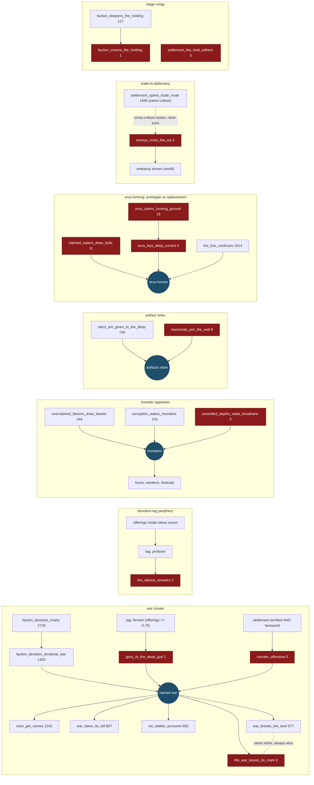

# Deletion survey: vestigial systems and low-impact content (2026-08-03)

Evidence base: the nine 30k-tick worlds (kindgen-r20*), pooled — about
262,000 world-ticks total. Fires/attempts below are 9-world totals.
Survey only; nothing deleted.

## Causality web of the candidates

Red nodes are deletion candidates; counts are 9-world totals.

## A. Dead or near-dead authored content (delete or retire candidates)

| item | kind | evidence (9-world total) |
|---|---|---|
| the_war_leaves_its_mark | generator | 0 fires — its gate never occurs |
| glory_to_the_dead_god | generator | 1 fire |
| the_silence_answers | generator | 2 fires, 0 entities |
| envoys_cross_the_ice | generator | 2 fires — soil-blocked since authoring (cross-culture trade routes absent); delete or keep as the trade-routes unblock target, not both |
| controlled_depths_wake_leviathans | generator | 5 fires |
| counter_offensive | generator | 5 fires |
| memorials_join_the_wall | generator | 8 fires |
| claimed_waters_draw_bulls | generator | 11 fires |
| faction_crowns_the_holding | gambit | 1 success in 9 attempts across nine worlds — the faction crown rung effectively does not exist |
| settlement_the_hold_withers | gambit | 5 successes — the demotion-pressure gambit has been near-dead since round 4 |
| orca_lays_deep_current | gambit | 5 successes — orca homing now flows through the_line_continues at scale; this prototype predates it |
| orca_claims_hunting_ground | gambit | 16 successes — exists mostly to feed orca_lays_deep_current |

Note: the backlog's "dead generators" entry is stale —
faction_claims_the_warm_ground no longer exists in the registered set,
and penguin_shelters_at_the_vent is a live gambit (549 successes).

## B. High authored surface, tiny yield (owner judgment)

- **Chronicle-gated remembrance** — the chronicle archetype surface is
  ~1,000 lines of authored beats/charges, and chronicle activity is
  1.7k events per world; the two chronicle-gated generators
  (the_ice_takes_notice 31, legend_enters_the_canon 14) fired 45 times
  total across nine worlds. Memory says named-entity heroics are core
  fiction, so this is a keep-and-cheapen or accept-rarity call, not a
  clean delete.
- **Low-fire wilds tail** — the_crater_keeps_its_count (10),
  legend_enters_the_canon (14), mapped_peaks_birth_techniques (16),
  the_watch_answers_the_song (19): each is a whole authored loop firing
  ~1-2 times per world. Individually defensible as rare flavor;
  collectively a lot of maintenance surface.
- **Desperation family** — NOT vestigial: under the rotating-leader
  regime all three surges now fire (beacon 30, every_debt 71,
  deep_song 142). The Aurora beacon placement defect remains.

## C. Overlap / consolidation candidates

- Three warden loops (wardens_take_up_the_old_forms 471,
  wardens_rise_where_the_hunt_bites 106, warded_monsters_found_orders
  36) — one theme, three generators; the smallest could fold in.
- orca_claims_hunting_ground + orca_lays_deep_current (see A) — the
  claim/settle pair is superseded by kind-general succession and the
  settle question was answered differently.

## D. Kernel-side vestiges and measure-first flags

- **Dead telemetry lanes**: cell_influence_events and
  culture_influence_action_field_events record 0 rows on every world —
  replaced by field snapshots in the perf rework; the recording
  plumbing is pure vestige.
- **generator_state_snapshots**: 510k rows/world = every generator's
  cooldown state every 5 ticks; the data is nearly static. Cheap to
  thin or drop.
- **generator_target_evaluations**: 9M rows/world and doubled by the
  kind-general dual-pool iteration; it exists for diagnosis (it found
  the surge placement defect) but is the single largest event lane and
  contributed to the 9100 publisher crash. Sampling candidate (already
  in the kernel-lane backlog).
- **Minor-actor encounters**: minor actors themselves are load-bearing
  (fronts, road crews, campaign columns), but the encounter subsystem
  emits ~0.9M events/world; measure what encounters change before
  keeping them at that volume.
- **Knowledge runtime grants**: claims are being made (136k claim
  snapshot rows/world) and modifiers feed fire weights and persistence,
  but whether any modifier deviates enough from 1.0 to matter has never
  been measured. Measure before the parked tech design builds on it.

## E. Explicitly not candidates (checked and earning their keep)

Minor-actor work (front/road/campaign carriers), roads (1M+ road events,
the travel-structure gambits run constantly), world beats (ages fire and
gate content), culture slots, the stages deepen/crown rungs for
settlement and canon (settlement_crowns 74, canon_crowns 73), the
offering/devotion economy (penguin_makes_offering 41k successes), and
the succession loop (the_line_continues 1,014 fires).
